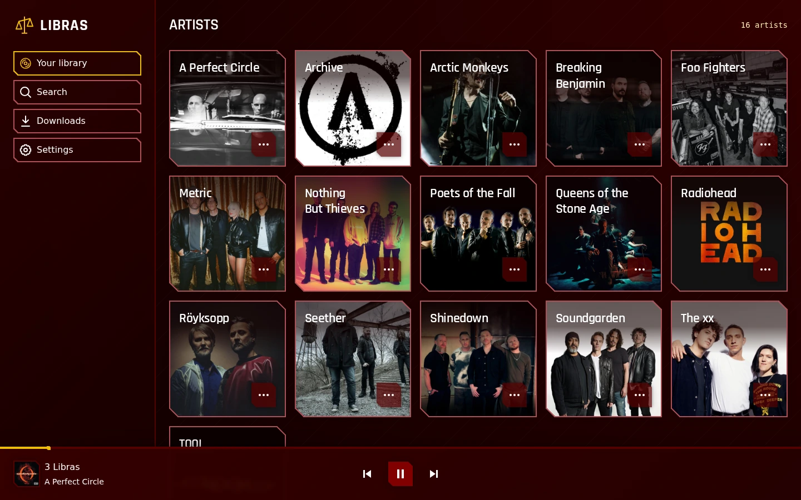

  

<h1 align="center">Libras</h1>

Libras is a browser-based minimalistic music player that connects to your own music server. Browse your library, play music, and download tracks to take with you.

> Named after “3 Libras” by A Perfect Circle.

## Features

- Browse artists, albums, and tracks.
- Stream music from your own server.
- Download music for offline playback and manage it in Settings → Downloads.
- Restore this device’s playback queue and position between sessions, without autoplay.
- Explicitly Load server queue or Save queue to server from Queue in navigation. Startup, reconnect, library refresh and playback never exchange server queues. Loading confirms replacement and stops playback only after a valid result arrives; failed/stale loads leave local state intact. Saving an empty queue confirms clearing the server queue. Duplicate and unavailable IDs are retained; Subsonic selection uses a track ID, so duplicate occurrences are ambiguous (the local occurrence is retained when membership matches, otherwise the first match is selected). The demo has no server queue exchange.
- Install as a standalone web app.

## Get started

1. Open [Libras](https://libras-music.app/webapp/).
2. Connect to your music server with your server address, username, and password.
3. Browse your library and start listening.

Just trying it out? Connect to the [Navidrome demo server](https://demo.navidrome.org/) using `https://demo.navidrome.org` as the server address and `demo` as both the username and password.

You'll need a reachable **HTTPS server with a Subsonic-compatible API**, such as [Navidrome](https://www.navidrome.org/), supporting OpenSubsonic's empty-query `search3` for library synchronization and configured to allow browser requests from `https://libras-music.app` (CORS). Libras is a player, not a music hosting service; bring your own server and library.

### Browser support

Safari 26.0 or newer is required; older Safari versions are not supported. The app uses native URLPattern and OPFS writable files. Safari 26.0–26.1 load Navigation API and invoker commands polyfills on demand; Safari 26.2+ use the native APIs. The dialog `closedby` polyfill and relative `rgb()` colors remain necessary for Safari 26. The standalone styleguide uses native browser features without polyfills.

### Authentication and device storage

Libras tries salted token authentication first; your password stays in the browser for that attempt. Only a structured server rejection of token authentication (Subsonic code 41 or 42) automatically retries the same username and password over HTTPS, including on localhost. Invalid credentials, connection failures, and other errors never trigger a password retry.

Credentials persist in **localStorage** until you disconnect. Token login saves the username, token, and salt, not your password. Successfully verified direct-password login saves the actual password and sends it with subsequent requests, including artwork and streaming URLs. HTTPS encrypts transport, not localStorage; scripts running on the app's origin and anyone with access to your browser profile can read saved credentials. Use a trusted device and server, and disconnect on shared devices. Disconnect removes credentials but retains your offline account, music, and queue.

## Install

You can use Libras in your browser or install it as a standalone web app:

- **iPhone/iPad:** Open in Safari, then choose **Share → Add to Home Screen**.
- **Android:** Choose **Install app / Add to home screen** from the browser menu.
- **Desktop:** Use the browser's install option, where available.

Installation options vary by browser and device. Offline storage and background playback have not yet been verified on iOS.

## Listen offline

Download music while connected, then choose **Work offline** in navigation or Settings. This turns off all server access, stops remote playback and pauses requested downloads while retaining their queued intent. Cached playback can continue. Choose **Connect** to resume queued downloads; failed jobs require Retry. Reconnecting never loads or saves the server queue.

**Library scope → All music / Downloaded** is independent of the connection. Downloaded filters browsing and search without disconnecting or changing your queue, position or active audio. All music can browse saved metadata offline; uncached tracks remain visible as unavailable.

- **Manage downloads:** Settings → Downloads.
- **Refresh library:** Automatic when opening online, or via Settings → Refresh library.
- **Disconnect:** Clears credentials and optionally deletes this account’s local cache and downloads. Remembered identity, preferences, other accounts and server data are unchanged. Close other Libras tabs before deleting local data.
- **Storage:** Each server/account has its own offline library, saved only in this browser on this device. **Clearing site data deletes it.**

## App updates

An app-update button beside Settings appears when an update is ready. Open it and choose **Update now** to install it—this reloads the app and interrupts playback.

## Development

This is a pnpm workspace: the root `libras` package contains the app, and [`@libras/website`](website/README.md) contains the landing page and a standalone live demo at `/demo/` that imports it. Run the website with `pnpm --filter @libras/website dev`, then open `/demo/` for the player.

See [CONTRIBUTING.md](CONTRIBUTING.md) for local setup, checks, deployment, and storage architecture.

## License

[MIT](LICENSE) © 2026 Bogdan Chadkin.
